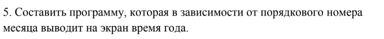
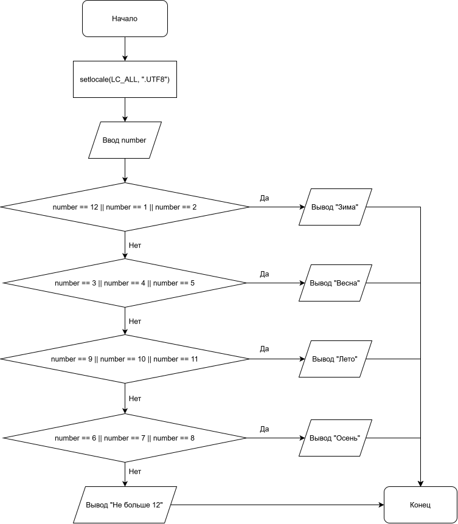

# # Лабораторная работа №7
---

## 1. Вариант

**Вариант 5**

---

## 2. Условие задачи



---

## 3. Блок-схема

* **Блок-схема:**
  <p align="center">
  
</p>

---

## 4. Реализация программы

```c
#include <stdio.h>
#include <locale.h>


int main() {
    setlocale(LC_ALL, ".UTF8");


    //Варик 5
    int number;
    scanf("%d", &number);

    switch (number)
    {
    case 12:
    case 1:
    case 2:
        printf("Зима");
        break;
    case 3:
    case 4:
    case 5:
        printf("Весна");
        break;
    case 6:
    case 7:
    case 8:
        printf("Лето");
        break;
    case 9:
    case 10:
    case 11:
        printf("Осень");
        break;
    default:
        printf("Не больше 12");
    }

    
    return 0;
}
```

---

## 5. Результат работы программы

**Входные данные (контрольный пример):**

***Ввод 1***
```text
number = 1
```
***Ввод 2***
```text
number = 3
```
***Ввод 3***
```text
number = 6
```
***Ввод 4***
```text
number = 9
```
***Ввод 5***
```text
number = 13
```

**Консольный вывод:**

***Вывод 1:***
```text
Зима
```
***Вывод 2:***
```text
Весна
```
***Вывод 3:***
```text
Лето
```
***Вывод 4:***
```text
Осень
```
***Вывод 5:***
```text
Не больше 12
```
---

## 6. Информация о разработчике

*Бурыкин Александр бТИИ-262*
